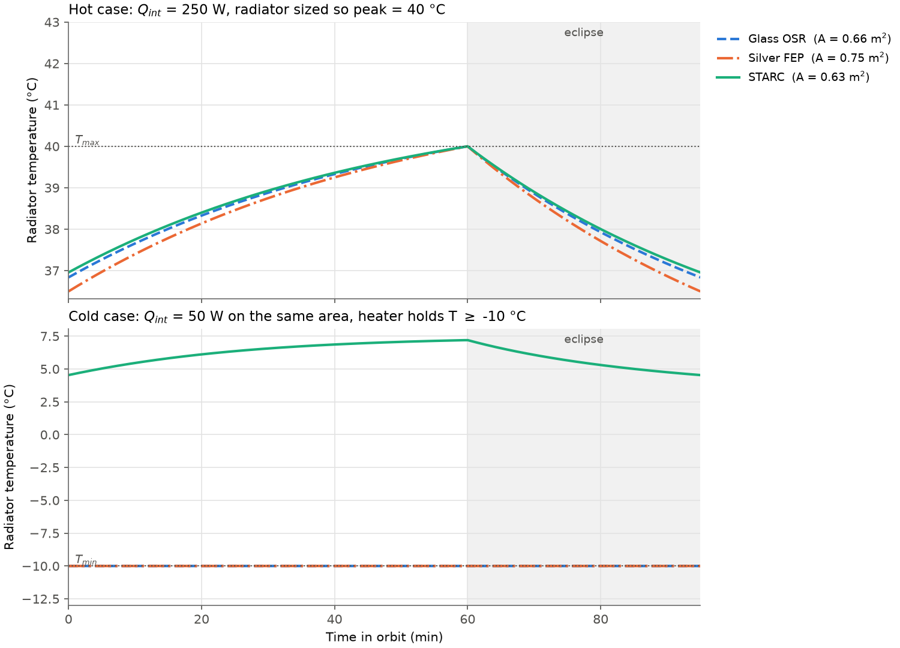
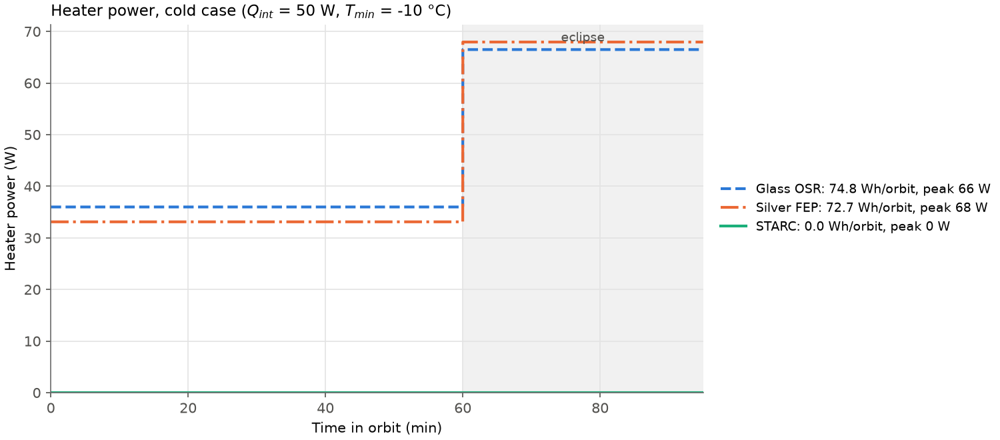
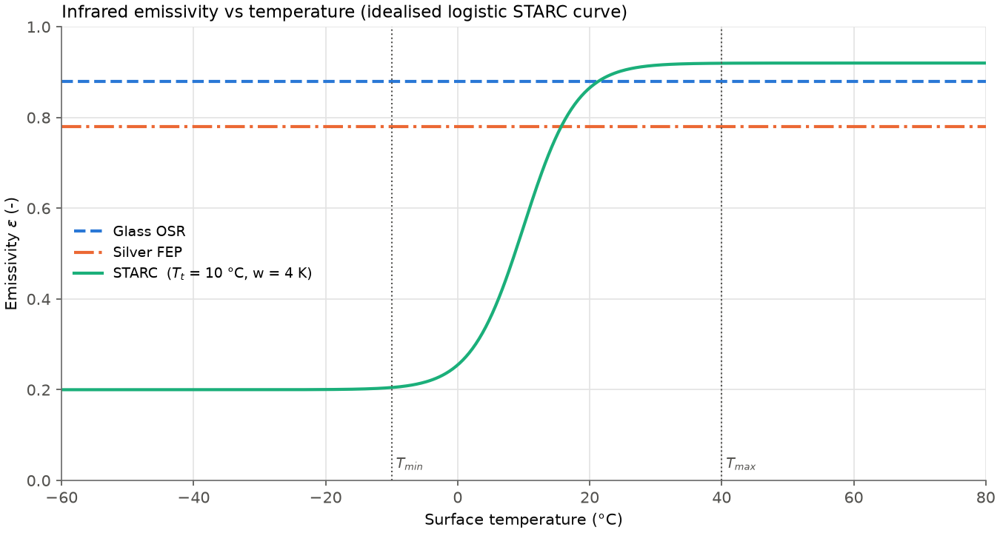
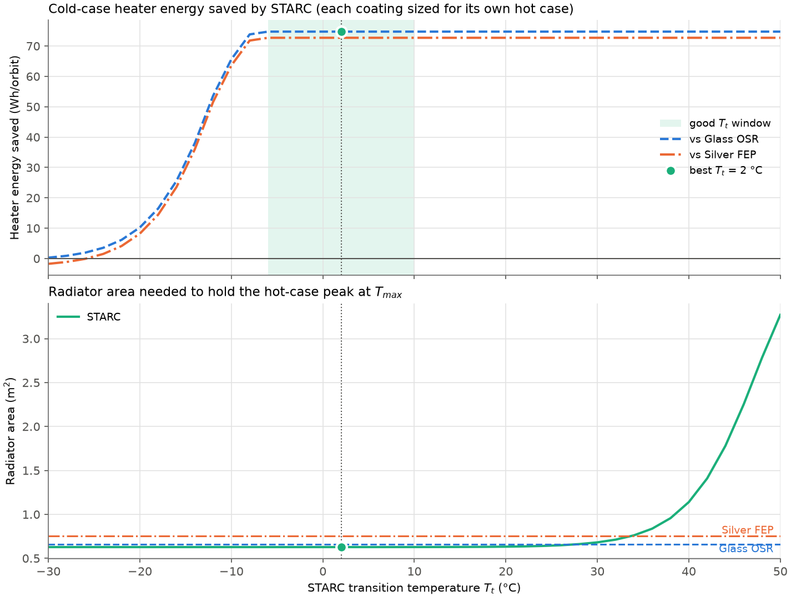
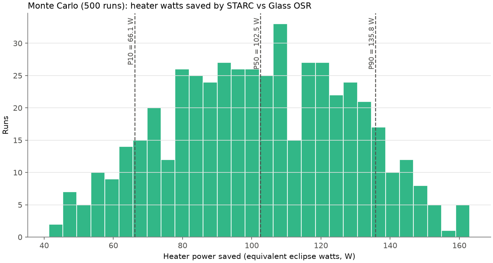

# STARC heater-power study (first-order model)

> **⚠ This is a first-order estimate built from public data only. It has NOT been validated against STARC test data, flight data or a correlated thermal model.** The STARC emissivity curve is an idealised logistic function, not measured behaviour. Use the results to understand trends and orders of magnitude, not for design margins or customer quotes.

This tool estimates how much heater power, battery and solar-array mass, and money an adaptive-emissivity radiator coating (like Aetara's STARC) saves compared with fixed-emissivity coatings (silver FEP, glass OSR). The scenario is a spacecraft radiator in low Earth orbit. Economic inputs come from Aetara White Paper 01 (Sep 2026).

## Quick start

```bash
pip install -r requirements.txt
python run_starc_study.py      # all studies, plots, summary (~30 s)
python -m pytest -v            # validation suite (~45 s)
```

Every input is in [`starc/params.py`](starc/params.py). Outputs are written to [`results/`](results/).

## Headline results (default inputs)

From [`results/summary.txt`](results/summary.txt):

| Coating | Radiator area | Cold-case heater | Peak heater | Cold-case temperature |
|---|---|---|---|---|
| Glass OSR (ε 0.88) | 0.659 m² | 74.8 Wh/orbit | 66.5 W | held at −10 °C |
| Silver FEP (ε 0.78) | 0.753 m² | 72.7 Wh/orbit | 67.9 W | held at −10 °C |
| STARC (ε 0.20→0.92) | 0.628 m² | 0 Wh/orbit | 0 W | floats at 4.5 to 7.2 °C |

Compared with OSR, STARC saves:

* 47 W of orbit-average heater power (67 W peak).
* 1.6 kg of battery and solar array.
* $15.8k to $84.5k per spacecraft, at the paper's $150 to $800 per heater watt.
* 4.7% of radiator area. Compared with FEP, the area saving is 16.6%.

**Monte Carlo (500 runs):** heater watts saved P10 / P50 / P90 = 66 / 103 / 136 equivalent eclipse watts.

**Transition-temperature sweep:** any T_t between about −6 and 10 °C gets the full saving with the smallest radiator. The best point is 2 °C, the middle of that window.

**How big is the saving?** With the default 50 W payload-off load, STARC needs no heater at all, so the saving is the fixed coating's entire heater demand. The saving is highly mission-dependent. It is driven mainly by the cold-case load, the view factors and T_min, which are this tool's own assumptions.

The summary also reports "W per sq ft" in the paper's mass-equivalent unit: about 15.6 W/sq ft. That is above the paper's own 15 W/sq ft upper bound and well above the 3 W/sq ft it credits for satellites. The reason is that this unit also counts heater power drawn in sunlight, which needs extra array. In plain orbit-average heater watts, the saving is about 7 W/sq ft.

| | |
|---|---|
|  |  |
|  |  |
|  | |

## What the model does

### Physics: one lumped radiator node

```
C dT/dt = Q_int + Q_solar + Q_albedo + Q_earthIR + Q_heater − ε(T) σ A T⁴

Q_solar   = α G A F_sun           (sunlit only)
Q_albedo  = α a G A F_earth       (sunlit only)
Q_earthIR = ε(T) q_IR A F_earth   (whole orbit)
```

* **Kirchhoff's law.** In the infrared, absorptance equals emittance, so the Earth-IR term uses the same ε(T) as emission. A cold STARC surface therefore also absorbs less Earth IR, which partly offsets its lower emission. Solar absorptance α is a separate, fixed property.
* **STARC emissivity:** `ε(T) = ε_c + (ε_h − ε_c) / (1 + exp(−(T − T_t)/w))`. A fixed coating is the same formula with ε_c = ε_h, so every coating runs through identical code.
* **Heater:** an ideal thermostat. After each step, if T fell below T_min, the heater adds exactly the energy needed to hold T_min. Heater power vs time is recorded.
* **Integration:** fixed-step RK4 at dt = 1 s. Sun/eclipse phase is constant inside each step because dt must divide both the sunlit time and the period. The energy tallies use the same RK4 weights as the temperature update, so the energy bookkeeping closes exactly.
* **Periodic steady state:** a secant iteration on the start-of-orbit temperature finds the orbit where T(end) = T(start) to within 10⁻⁴ K, usually in 2–6 orbits. The final (last) orbit is reported. All cases (coatings, sweep points, Monte Carlo draws) run together as numpy vectors.
* **Thermal capacitance:** `C = (5 kg/m² × A + 10 kg) × 900 J/kg·K`.

### Fair comparison

A lower-ε fixed coating needs a bigger radiator to reject the same heat. That bigger radiator then overcools more in the cold case. To compare fairly, each coating is treated the same way:

1. **Size** the radiator area A (Illinois root-finder on log A) so the **hot case** peaks at exactly T_max = 40 °C. The hot case is sunlit orbit with high Q_int.
2. **Run the cold case** (low Q_int) on that same area. Record heater energy per orbit, split into eclipse and sunlit parts, plus peak heater power.

### Economics (white paper Step 2 and Table 3)

* Battery mass = eclipse heater energy ÷ 150 Wh/kg.
* Array mass = (eclipse energy ÷ 0.85 + sunlit heater energy) ÷ 60 min of sun ÷ 60 W/kg.
* One "heater watt" (the paper's unit) is 1 W held through the 35-minute eclipse. That costs 3.9 g of battery plus 11.4 g of array, 15.3 g in total. Any heater profile is converted into **equivalent eclipse watts** by mass. The paper's **$150 (constellation) to $800 (science) per watt** is then applied. Launch cost alone ($7,000/kg) is also reported.
* $ per sq ft = $ saved ÷ STARC radiator area in sq ft.
* Radiator area saved = (A_fixed − A_STARC) / A_fixed.

### Studies

1. Nominal comparison: FEP, OSR and STARC at dt = 1 s.
2. Orbit plots: temperature (hot and cold cases) and heater power (cold case).
3. The ε(T) curve.
4. **T_t sweep (−30 to 50 °C, 2 °C steps).** For each T_t, STARC is re-sized and re-run. The "good window" is the set of T_t values whose heater saving is within 0.5% of the maximum and whose radiator is within 0.1% of the smallest area. The marked best point is the centre of that window, which gives the most margin against T_t uncertainty.
5. **Monte Carlo (500 runs, seed 1).** Uniform draws of the uncertain inputs. The runs are *paired*: each draw is applied to both STARC and the baseline (OSR), both are re-sized, then compared. The output is equivalent eclipse heater watts saved, with P10/P50/P90.

The sweep and Monte Carlo use dt = 5 s for speed. The script checks this against dt = 1 s and reports the difference in `summary.txt`. It is currently 0.04% of heater energy.

## Assumptions and sources

Source tags: **[WP-T3]** Aetara White Paper 01 (Sep 2026), Table 3 · **[WP-S1/S2]** the paper's Customer Economics, Steps 1 and 2 · **[WP-A]** STARC properties the paper cites as company data · **[STD]** standard value · **[ASSUME]** chosen for this tool.

| Parameter | Default | Source |
|---|---|---|
| Orbit period / sunlit / eclipse | 95 / 60 / 35 min | [WP-T3] |
| Solar constant G | 1361 W/m² | [STD] |
| Earth albedo a | 0.30 | [STD] |
| Earth IR q_IR | 237 W/m² | [STD] |
| Solar projection factor F_sun | 0.25 | [ASSUME] |
| Earth view factor F_earth | 0.30 | [ASSUME] |
| Panel areal mass | 5 kg/m² | [WP-T3] (NASA advanced-radiator target) |
| Equipment mass on node | 10 kg | [ASSUME] |
| Specific heat c_p | 900 J/kg·K (aluminium) | [STD] |
| T_max (sizing) / T_min (heater) | 40 °C / −10 °C | [ASSUME]; −10 °C matches [WP-S1] |
| Q_int hot / cold | 250 W / 50 W | [ASSUME] (payload on / off) |
| Silver FEP ε, α | 0.78, 0.10 | ε within 0.75–0.82 [WP-T3, Sheldahl]; α [ASSUME] |
| Glass OSR ε, α | 0.88, 0.10 | [STD] |
| STARC ε_c, ε_h | 0.20, 0.92 | within ~0.20–0.95 [WP-A] |
| STARC T_t, w, α | 10 °C, 4 K, 0.10 | [ASSUME] (user inputs) |
| Battery specific energy | 150 Wh/kg | [WP-T3] |
| Array specific power | 60 W/kg | [WP-T3] |
| Recharge efficiency | 0.85 | [WP-T3] |
| Rideshare launch | $7,000/kg | [WP-T3] (SpaceX) |
| Value of a heater watt | $150–$800 | [WP-S2] |
| Monte Carlo ranges | w 2–8 K, ε_c 0.15–0.30, ε_h 0.85–0.95, Q_int ×0.8–1.2, Δα −0.02 to +0.08 | [ASSUME] |

## Validation ([`tests/test_validation.py`](tests/test_validation.py)): all 7 pass

| Test | Checks |
|---|---|
| `test_step1_radiated_flux` | At −10 °C, ε 0.80 radiates ~217 W/m² and ε 0.20 ~54 W/m² (paper Step 1) |
| `test_heater_watt_cost` | 1 W over a 35-min eclipse gives 3.9 g battery + 11.4 g array = 15.3 g (paper Step 2) |
| `test_orbital_datacenter_area` | 330 K, ε 0.90, two faces, 150 W/m² per face, 1 MW + 10% needs ~1,200 m² (paper) |
| `test_logistic_curve_shape` | ε(T_t) is the midpoint, the curve has the right limits, and it is monotonic |
| `test_equal_emissivities_give_fixed_coating` | STARC with ε_c = ε_h = 0.88 gives the same area, heater energy and T history as OSR |
| `test_periodic_energy_closure` | Energy in = energy out over the last orbit within 1% (actual ~1e-9); independent trapezoid re-integration of emission; sized hot peak = T_max |
| `test_timestep_convergence` | Halving dt (1 → 0.5 s) changes area, heater energy and savings by < 0.5% |

These tests check that the code reproduces the paper's hand calculations and that the numerics are sound. **They do not show that the model predicts real STARC hardware.**

## Limitations

* **One node.** The radiator, heat-transport path and equipment are a single isothermal mass. There are no temperature gradients across the panel, no heat-pipe or loop dynamics, and no separate component limits.
* **No view-factor geometry.** F_sun and F_earth are fixed effective constants. No attitude, panel orientation, spacecraft self-blockage or specular reflection is modelled.
* **No beta angle or seasons.** The orbit uses one fixed 60/35-minute split. There are no full-sun orbits, no eclipse-season changes, and no variation in solar flux (1322–1414 W/m²), albedo or OLR around the orbit.
* **No lateral conduction** or coupling to the rest of the spacecraft. The back side is adiabatic.
* **Idealised logistic ε(T).** There is no hysteresis, no angular or spectral dependence, no ageing, and no switching dynamics. The real STARC curve is not public.
* **Grey-body IR** with a single ε for emission and Earth-IR absorption. Solar absorptance α is fixed apart from the Monte Carlo Δα.
* **Ideal heater.** It is a perfect thermostat with no deadband, no power limit, and no heater or harness mass.
* **Hot and cold cases share the same environment.** A real design would use worst-case hot environment and end-of-life α for sizing, and a cold environment with beginning-of-life α for heater sizing.
* **Economics are gross.** STARC's own price premium, qualification cost and integration cost are not subtracted. Mass savings are valued as launch cost *or* $/W, not both. Battery sizing uses usable specific energy, with no separate depth-of-discharge or ageing margin.
* **Not correlated to test data.** No thermal-vacuum, flight or supplier data were used. The Monte Carlo ranges are judgement calls.

## Next steps

1. Replace the logistic curve with measured STARC ε(T), including hysteresis, and add α for STARC.
2. Add orbit geometry: beta angle, attitude and orbit-varying view factors (or import Thermal Desktop / ESATAN orbital heat rates).
3. Build a multi-node model: panel, heat pipes or loop, equipment, and conduction to the spacecraft.
4. Use distinct hot/cold environments (EOL/BOL α, min/max solar, albedo and OLR) and payload duty cycles.
5. Correlate against thermal-vacuum test data, then against flight data.
6. Net the economics against STARC's incremental cost, and add heater hardware and louver/valve mass avoided.
7. Replace the uniform Monte Carlo ranges with distributions fitted to test data.

## Repository layout

```
run_starc_study.py         one-command driver (studies, plots, summary)
starc/params.py            every input, with sources
starc/model.py             RK4 one-node model, periodic solver, sizing, comparison
starc/economics.py         battery / array mass and $ (paper Step 2), hand-calc helpers
tests/test_validation.py   pytest validation suite
results/                   generated plots and summary.txt
matlab/                    original MATLAB version (reference only, not run)
```
